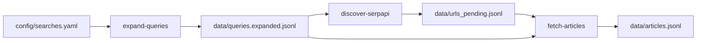

# news-scraping-pe

Coleta histórica **única** de notícias em mídia aberta sobre ações judiciais contra candidatos a **Presidente da República** e **Governador de Pernambuco** (eleições **2018** e **2022**). Projeto de pesquisa acadêmica — não é monitoramento contínuo.

## Objetivo

| Fase | Escopo |
|------|--------|
| **1 (este repositório)** | Descobrir URLs, extrair **texto bruto** e metadados (`view_count` opcional) |
| **2 (fora deste repo)** | Data science — correlação com pesquisas de intenção de voto |

## Decisões de projeto (estado atual)

- **Escopo eleitoral:** 2018 e 2022 apenas (2014 fora do projeto).
- **Varredura única** por combinação candidato + termo + portal; sem crawler contínuo.
- **Portais compartilhados:** todos os portais habilitados em `searches.yaml` entram na expansão para **cada** candidato (`presidente` e `governador_pe`); o cargo vem do candidato, não do portal.
- **Configuração central:** [`config/searches.yaml`](config/searches.example.yaml) — candidatos, termos, janelas, portais.
- **Execução:** [`data/queries.expanded.jsonl`](data/queries.expanded.example.jsonl) — jobs gerados por `expand-queries` (**720** jobs com `searches.example.yaml`, 8 portais).
- **Descoberta via SerpAPI** (Google News) + **extração** com trafilatura — **implementado**.
- **Spiders Scrapy** por portal — planejados (passos 10–12 do [roadmap](docs/ROADMAP.md)).

## Pipeline (SerpAPI + extração)



Guia passo a passo com SerpAPI: **[docs/guia-serpapi.md](docs/guia-serpapi.md)**.

## Estrutura do repositório

```
news-scraping-pe/
├── config/
│   ├── searches.example.yaml   # template versionado
│   └── searches.yaml           # sua config local (gitignored)
├── data/
│   ├── queries.expanded.jsonl  # jobs (gitignored)
│   ├── urls_pending.jsonl      # URLs descobertas (gitignored)
│   └── articles.jsonl          # artigos extraídos (gitignored)
├── docs/
│   ├── guia-serpapi.md         # como rodar o fluxo SerpAPI
│   ├── article_schema.json
│   ├── search_config_schema.json
│   └── ROADMAP.md
├── src/news_scraping_pe/
│   ├── cli.py                  # comandos da CLI
│   ├── config/                 # loader do YAML
│   ├── discovery/              # SerpAPI, jobs, orquestrador
│   ├── extraction/             # trafilatura, fetch-articles
│   ├── storage/                # urls pendentes, artigos, dedup
│   ├── env.py                  # carrega .env por caminho explícito
│   └── scrapy/                 # spiders (em desenvolvimento)
├── tests/
├── scrapy.cfg
├── pyproject.toml
└── uv.lock
```

## Pré-requisitos

- [uv](https://docs.astral.sh/uv/)
- Python **3.12** (ver [`.python-version`](.python-version))
- Conta [SerpAPI](https://serpapi.com/) com créditos para Google News

## Configuração inicial

```bash
git clone git@github.com:SEU_USUARIO/news-scraping-pe.git
cd news-scraping-pe

uv sync

cp .env.example .env
# Edite .env: SERPAPI_API_KEY=...

cp config/searches.example.yaml config/searches.yaml
# Revise candidatos, termos e portais conforme a pesquisa
```

## Comandos da CLI

Todos os comandos carregam `.env` automaticamente e aceitam `-v` / `--verbose` para log `DEBUG`.

| Comando | Descrição |
|---------|-----------|
| `validate-config` | Valida `searches.yaml` contra JSON Schema |
| `expand-queries` | Gera `data/queries.expanded.jsonl` |
| `discover-serpapi` | Consulta SerpAPI e grava `data/urls_pending.jsonl` |
| `fetch-articles` | Baixa URLs pendentes, extrai texto, grava `data/articles.jsonl` |

Exemplo mínimo (após configurar `.env`):

```bash
uv run news-scraping-pe validate-config
uv run news-scraping-pe expand-queries
uv run news-scraping-pe discover-serpapi --job-id lula_2022__processo__g1 --limit 1
uv run news-scraping-pe fetch-articles --job-id lula_2022__processo__g1 --limit 5
```

Detalhes, filtros, custos e troubleshooting: **[docs/guia-serpapi.md](docs/guia-serpapi.md)**.

## Arquivos de dados

| Arquivo | Conteúdo |
|---------|----------|
| `queries.expanded.jsonl` | Um job por linha: `job_id`, `search_query`, `portal_id`, janela de datas, metadados |
| `urls_pending.jsonl` | URLs descobertas: `url`, `job_id`, `discovered_via` |
| `articles.jsonl` | Artigos finais conforme [`docs/article_schema.json`](docs/article_schema.json) |

Exemplos versionados: `data/*.example.jsonl`.

## Desenvolvimento

```bash
uv sync
uv run pre-commit install   # opcional
make lint test
```

| `make` | Ação |
|--------|------|
| `lint` | ruff + mypy |
| `test` | pytest (51 testes) |
| `validate-config` | atalho para validação |
| `expand-queries` | atalho para expansão |
| `discover-serpapi` | 1 job SerpAPI (teste) |
| `fetch-articles` | 3 URLs (teste) |

Ver [CONTRIBUTING.md](CONTRIBUTING.md) e [docs/ROADMAP.md](docs/ROADMAP.md).

## Licença

MIT — [LICENSE](LICENSE).
